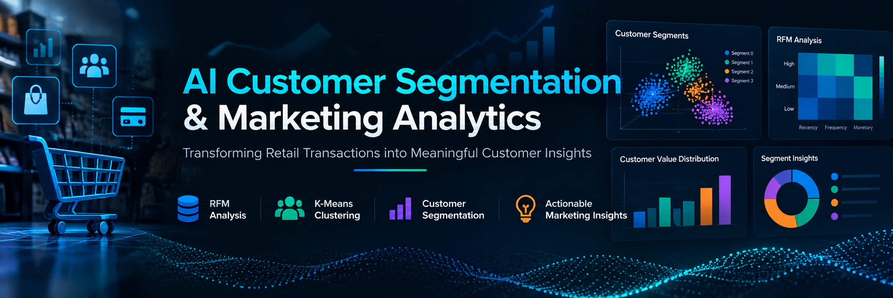
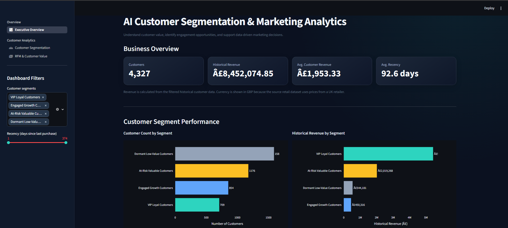
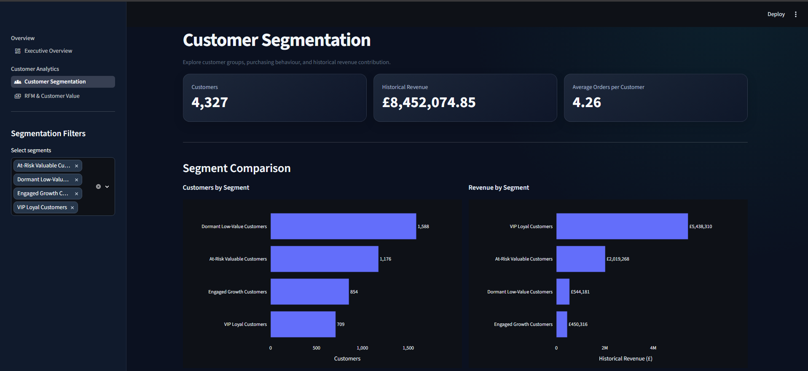
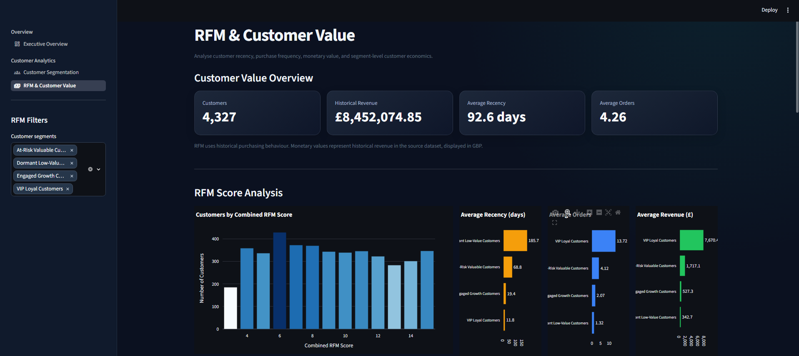
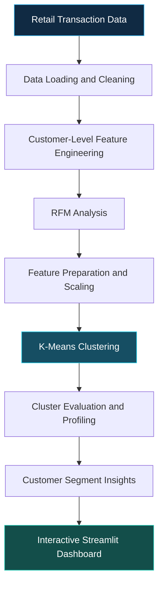

# AI Customer Segmentation & Marketing Analytics

<div align="center">
  
  
  **Transform Retail Transactions into Actionable Customer Insights**

  An end-to-end data analytics and machine learning project using RFM analysis, K-Means clustering, and an interactive Streamlit dashboard to understand customer purchasing behavior and customer value.

  
  
  
  
  
</div>

---

## 📌 Project Overview

Customer segmentation helps businesses understand their customers, identify purchasing patterns, and develop more targeted marketing strategies.

This project analyzes retail transaction data to derive customer-level **Recency, Frequency, and Monetary (RFM)** metrics. It applies **K-Means clustering** to group customers based on purchasing behavior and presents analytical findings through an interactive Streamlit dashboard.

The project demonstrates an end-to-end workflow covering data preparation, feature engineering, unsupervised machine learning, model evaluation, and business intelligence visualization.

## 🚀 Live Demo

[https://customer-segmentation-marketing-analytics-dashboard.streamlit.app/](https://customer-segmentation-marketing-analytics-dashboard.streamlit.app/)


## 🎯 Project Objectives

- Analyze customer purchasing behavior using transaction data.
- Calculate customer-level RFM metrics.
- Identify groups of customers with similar behavioral patterns.
- Evaluate clustering results and compare segment characteristics.
- Visualize customer value and segment distributions.
- Present analytical findings through an interactive dashboard.

## ✨ Key Features

| Feature | Description |
|---|---|
| RFM Analysis | Calculate Recency, Frequency, and Monetary metrics to understand customer behavior. |
| Customer Segmentation | Apply K-Means clustering to group customers using behavioral features. |
| Model Evaluation | Examine clustering evaluation metrics and segment profiles. |
| Interactive Dashboard | Explore analytical results through a multi-page Streamlit application. |
| Customer Value Analysis | Compare customer value and purchasing patterns across segments. |
| Data Processing Pipeline | Organize data loading, preprocessing, feature engineering, and clustering. |
| Visual Analytics | Explore segment distributions, RFM comparisons, and customer-value charts. |
| Saved Model Artifacts | Reuse the trained clustering model, feature scaler, and segment mapping. |

## 📊 Dashboard Preview

### 1. Executive Overview

Explore the overall customer analytics results and key visual summaries.



### 2. Customer Segmentation

Analyze customer clusters and compare their behavioral characteristics.



### 3. RFM & Customer Value

Explore RFM metrics and customer-value comparisons to better understand purchasing behavior.



## ⚙️ Technology Stack

| Category | Technologies |
|---|---|
| Programming Language | Python |
| Data Analysis | Pandas, NumPy |
| Machine Learning | Scikit-learn, K-Means Clustering |
| Data Visualization | Matplotlib, Plotly |
| Dashboard Development | Streamlit |
| Model Persistence | Joblib |
| Development Environment | Jupyter Notebook, VS Code |
| Version Control | Git, GitHub |

## 🔄 Analytical Workflow

The project follows a structured data analytics workflow, from transaction data preparation to interactive reporting.



## 📁 Project Structure

```text
AI-Customer-Segmentation-Marketing-Analytics/
│
├── app.py
├── run_pipeline.py
├── requirements.txt
├── README.md
├── LICENSE
├── .gitignore
│
├── assets/
│   ├── readme-banner.png
│   ├── dashboard-overview.png
│   ├── customer-segmentation.png
│   └── rfm-customer-value.png
│
├── dashboard/
│   ├── overview.py
│   └── pages/
│       ├── 1_Customer_Segmentation.py
│       └── 2_RFM_Customer_Value.py
│
├── data/
│   └── raw/                 # Local source data; not committed
│
├── models/
│   ├── customer_segmentation_scaler.joblib
│   ├── kmeans_customer_segmentation.joblib
│   └── segment_mapping.json
│
├── notebooks/
│   └── customer_segmentation_analysis.ipynb
│
├── reports/
│   ├── cluster_distribution.png
│   ├── cluster_evaluation.csv
│   ├── cluster_profiles.csv
│   ├── customer_value_comparison.png
│   ├── pca_customer_segments.png
│   ├── rfm_comparison.png
│   └── segment_summary.csv
│
└── src/
    ├── clustering.py
    ├── dashboard_theme.py
    ├── data_loader.py
    ├── feature_engineering.py
    ├── insights.py
    ├── model_preparation.py
    ├── preprocessing.py
    ├── rfm_analysis.py
    └── visualization.py
```

*Note: The tree highlights the main project files. Some generated reports or local data files may not be present in a fresh clone.*

## 🚀 Installation and Setup

### Prerequisites

- Python installed on your system
- Git
- A compatible retail transaction dataset
- Access to the project dependencies listed in `requirements.txt`

### 1. Clone the repository

```bash
git clone https://github.com/SommayDewat/AI-Customer-Segmentation-Marketing-Analytics.git
cd AI-Customer-Segmentation-Marketing-Analytics
```

### 2. Create a virtual environment

On Windows PowerShell:

```powershell
python -m venv .venv
.\.venv\Scripts\Activate.ps1
```

If PowerShell blocks script execution, use an appropriate environment activation method for your system rather than changing system-wide security settings unnecessarily.

### 3. Install dependencies

```powershell
python -m pip install -r requirements.txt
```

### 4. Configure the dataset

The raw transaction dataset is not included in this repository. Obtain a compatible dataset and place it at the location expected by `src/data_loader.py`.

Before running the pipeline, check the data loader for the expected file path, required column names, date format, and transaction structure.

### 5. Launch the dashboard

```powershell
streamlit run app.py
```

Open the local URL printed in the terminal to access the dashboard.

### 6. Run the data pipeline

```powershell
python run_pipeline.py
```

Make sure the required dataset is available before running the pipeline. Review the script and configuration for any additional input requirements.

## 📈 Model Evaluation and Outputs

The project includes artifacts and analytical outputs for exploring customer segments, including:

- Cluster evaluation metrics
- Cluster profiles and segment summaries
- Customer segment distribution visualizations
- RFM comparison charts
- Customer-value comparison charts
- PCA-based customer segment visualization
- A saved K-Means model and feature scaler

These outputs help examine the clustering results and interpret differences between customer groups. Actual model quality should be assessed using the generated evaluation results and the characteristics of the selected dataset.

## 💼 Business Applications

The analysis can support business activities such as:

- **Customer Retention:** Identify customer groups that may require additional engagement.
- **Customer Value Analysis:** Compare customer value across behavioral segments.
- **Targeted Marketing:** Develop segment-specific campaign strategies.
- **Customer Behavior Analysis:** Understand differences in purchasing frequency and spending.
- **Data-Driven Decisions:** Use customer-level metrics to support marketing planning.

These are potential applications of the analysis, not claims of measured business impact.

## 🔮 Potential Future Improvements

- Add customer lifetime value estimation.
- Integrate automated data refresh and scheduled reporting.
- Add segment-specific marketing recommendations.
- Compare alternative clustering algorithms and feature sets.
- Deploy the dashboard to a public hosting platform.
- Add reproducible experiments and automated model evaluation.

## 👨‍💻 Author

**Sommay Dewat**

- GitHub: [SommayDewat](https://github.com/SommayDewat)
- LinkedIn: [Connect on LinkedIn](https://www.linkedin.com/in/sommay-dewat/)

## 📄 License

This project is licensed under the MIT License. See the [LICENSE](LICENSE) file for details.

---

<div align="center">

**Built with Python, Machine Learning, and Business Intelligence**

</div>
